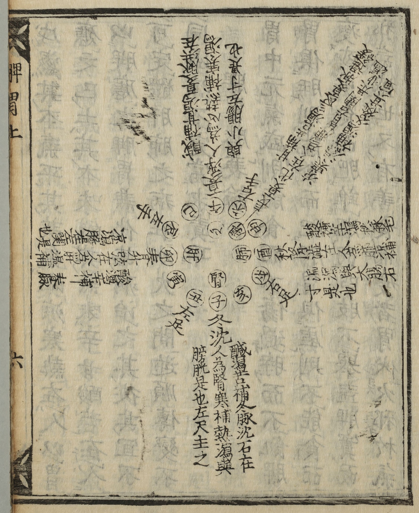

# 脾胃論 巻上 002 臓気法時升降浮沈補瀉図説

## 原文

図は『東垣十書』（京都大学附属図書館所蔵）の脾胃論巻上の一部を切り抜いたもの（[京都大学貴重資料デジタルアーカイブ](https://rmda.kulib.kyoto-u.ac.jp/item/RB00004306)）。和刻本で、底本（明の仁寿堂刊本）とは版が異なる。

五行相生、木、火、土、金、水、循環無端、惟脾無正行、於四季之末各旺一十八日、以生四臓。四季者、辰、戌、丑、未是也。人身形以応九野、左足主立春、丑位是也；左手主立夏、辰位是也；右手主立秋、未位是也；右足主立冬、戌位是也。戌湿、其本気平、其兼気温、涼、寒、熱、在人以胃応之；己土、其本味鹹、其兼味辛、甘、酸、苦、在人以脾応之。脾胃兼化、其病治之、各従其宜、不可定体；肝肺之病、在水火之間、順逆伝変不同、温涼不定、当求責耳。

## 校異・校訂・注釈

【校異】「端惟脾無正**行**於四季之末」の太字の部分は、Wikisourceは「形」に作る。

【校異】「端惟脾無正**行**於四季之末」の太字の部分は、Wikisource（四庫全書本）は「形」に作る。

【校異】「端惟脾無正**行**於四季之末」の太字の部分は、四庫全書本は「形」に作る。

【校異】「冬戌位是也**戌湿**其本気平其」の太字の部分は、Wikisource（四庫全書本）は「戊土」に作る。

【校異】「冬戌位是也**戌湿**其本気平其」の太字の部分は、四庫全書本は「戊土」に作る。

【校異】「戌位是也戌**湿**其本気平其」の太字の部分は、Wikisourceは「土」に作る。

【校異】「人以胃応之**己**土其本味鹹」の太字の部分は、Wikisource（四庫全書本）は「巳」に作る。

【校異】「人以胃応之**己**土其本味鹹」の太字の部分は、四庫全書本は「巳」に作る。

【校異】「化其病治之**各**従其宜不可」の太字の部分は、Wikisourceは「其」に作る。

【校異】「化其病治之**各**従其宜不可」の太字の部分は、Wikisource（四庫全書本）は「其」に作る。

【校異】「化其病治之**各**従其宜不可」の太字の部分は、四庫全書本は「其」に作る。

【校異】「在水火之間」と「順逆伝変不」の間に、Wikisourceは「逆」がある。

【校異】「在水火之間」と「順逆伝変不」の間に、Wikisource（四庫全書本）は「逆」がある。

【校異】「在水火之間」と「順逆伝変不」の間に、四庫全書本は「逆」がある。

【校異】「水火之間順**逆**伝変不同温」の太字の部分は、Wikisourceにない。

【校異】「水火之間順**逆**伝変不同温」の太字の部分は、四庫全書本にない。
